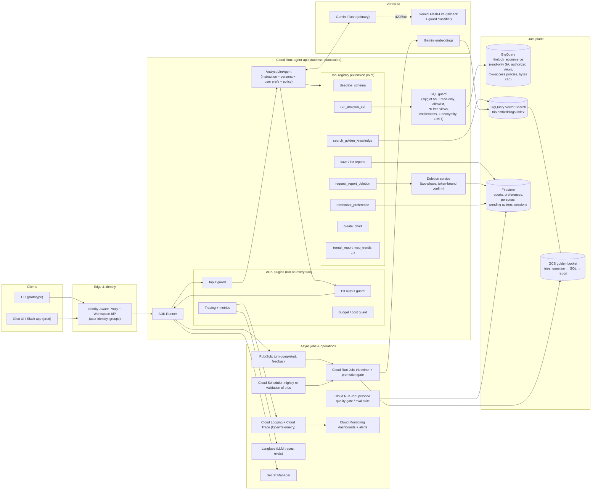
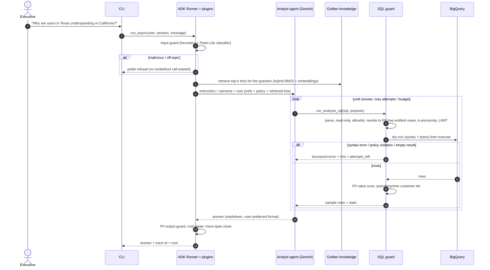
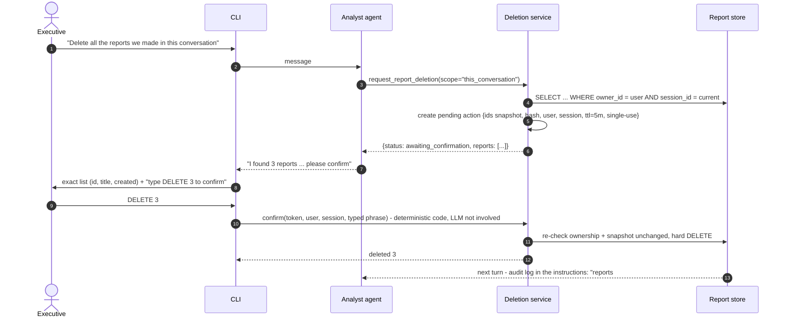

# Architecture (HLD)

This document is the high-level design: building blocks, services, compute, data stores and the
flows between them. The *why* behind each choice and the per-requirement details are in
[TECHNICAL_DESIGN.md](TECHNICAL_DESIGN.md).

The prototype in this repository implements the same building blocks with local stand-ins
(table at the end), so every box below has running code behind it.

## 1. Production architecture on Google Cloud

### Compute & communication

| Component | Runs on | Talks to | Protocol |
|---|---|---|---|
| Chat front (CLI / web / Slack) | user device / Cloud Run | agent-api | HTTPS (SSE streaming), IAP-authenticated |
| agent-api (ADK Runner, plugins, tools) | Cloud Run, min 1 instance, concurrency 20 | Vertex AI, BigQuery, Firestore, Pub/Sub | gRPC / REST client libraries, service account per env |
| Gemini models | Vertex AI (regional endpoint) | - | REST, per-request timeout, retry on 429/5xx, model fallback |
| SQL execution | BigQuery (on-demand) | - | Jobs API: dry-run first, then query with `maximum_bytes_billed` |
| Golden retrieval | BigQuery Vector Search over GCS-ingested trios | - | SQL `VECTOR_SEARCH` + BM25 keyword fallback |
| Async learning / gates | Cloud Run Jobs fed by Pub/Sub + Scheduler | GCS, BigQuery, Firestore | push subscriptions |
| Telemetry | OpenTelemetry SDK in agent-api | Cloud Trace / Logging, Langfuse | OTLP |

### Where data lives

| Data | Store | Retention / notes |
|---|---|---|
| Raw transactions | BigQuery `thelook_ecommerce` (read-only) | never copied; the agent sees only policy views |
| Golden trios | GCS `gs://<env>-golden-knowledge/trios/*.yaml` (+ embeddings in BigQuery) | versioned objects; status `candidate` / `active` / `deprecated` |
| Conversation sessions | Firestore (ADK session service) | 90 days |
| Saved reports | Firestore `reports/{id}` (owner-scoped) + search index | hard delete on request, no recovery (client requirement) |
| User preferences | Firestore `users/{id}/preferences` | until user resets |
| Personas | Firestore `personas/{name}/versions/{n}` + `active` pointer | full history for rollback |
| Pending destructive actions | Firestore (TTL 5 min) | single use |
| Traces & metrics | Cloud Logging / Trace, BigQuery log sink, Langfuse | 30 days hot, 1 year in BigQuery |
| Secrets (API keys, pseudonym HMAC key) | Secret Manager | rotated |

**PII never leaves BigQuery**: the SQL guard rewrites every query onto policy views that do not
contain PII columns, so PII is never in a result set, never in the LLM context, never in logs.

## 2. Request flow: an analysis question

## 3. Destructive operation flow: deleting reports

## 4. Prototype mapping

| Production building block | Prototype stand-in (this repo) |
|---|---|
| Cloud Run agent-api | local Python process (`retail-agent chat`) running the same ADK Runner |
| Vertex AI Gemini | Gemini API (AI Studio key) via ADK `Gemini` + `FallbackModel`; offline: Ollama via `LiteLlm` or a deterministic scripted model |
| BigQuery | BigQuery (`bigquery-public-data.thelook_ecommerce`); offline: DuckDB synthetic copy with the same schema (SQL transpiled by sqlglot) |
| GCS golden bucket + Vector Search | `data/golden/trios/*.yaml` + BM25 (+ Gemini embeddings when online), RRF fusion |
| Firestore | SQLite `var/app.sqlite` (reports + FTS5, preferences, personas, pending actions, traces) and `var/sessions.sqlite` (ADK sessions) |
| Cloud Trace / Logging / Langfuse | trace plugin writing spans to SQLite + `var/traces.jsonl`; `/trace` and `retail-agent stats` |
| Cloud Run Jobs (gates) | `retail-agent persona publish`, `retail-agent learn`, `python evals/run_evals.py` |
| IAP identity | `--user` flag mapped to `config/entitlements.yaml` |
